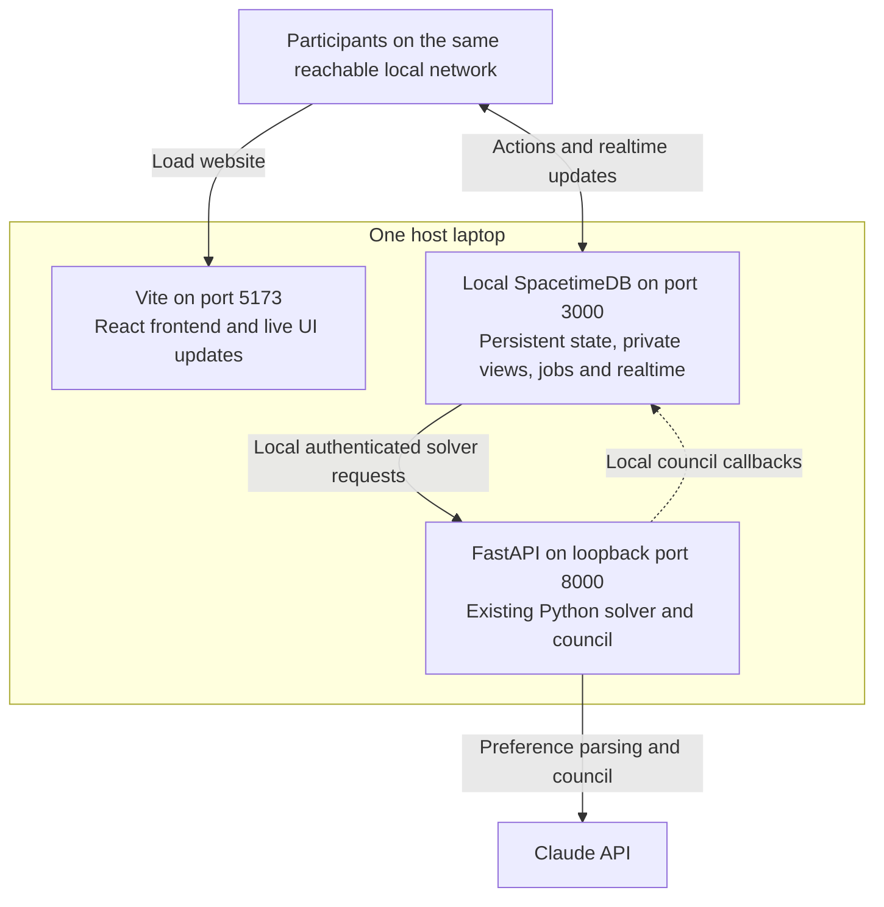

# Single laptop demo change plan

## Status October 24 superseded for the shared demo

The all-local proposal below is retained for reference. It is not the current
deployment plan. An isolated test on SpacetimeDB 2.13.0 reproduced a procedure
HTTP failure when calling a reachable loopback endpoint: `refusing to connect to
private or special-purpose addresses`. Phase 1 therefore fails as written.
Moving all services onto one laptop would also retain that laptop as the shared
demo's availability dependency.

The current direction is [CURRENT_CONTEXT.md](CURRENT_CONTEXT.md): agent-led
planning with code-enforced hard constraints, separate Vite/FastAPI processes
for local development, and Vercel + Maincloud + local FastAPI behind a public
tunnel for the shared app. The laptop availability dependency is accepted for
this phase. Hosted API migration is deferred; no hosting cutover has happened.
Review [AGENT_FLOW_PLAN.md](AGENT_FLOW_PLAN.md). Do not implement the historical
all-local database launcher or preserve its mathematical requirements as new
product requirements.

## Original proposal

Proposed implementation, October 24, 2026. The earlier direction was one laptop
running three separate processes: Vite for the React frontend, FastAPI for the
Python solver/council, and local SpacetimeDB for state and realtime. This plan
covers the startup and connection changes needed to demonstrate Huddle with
several people using their own phones.

The operating goal is **one setup command per host machine, one startup command
per session, and one website link for participants**. The launcher manages the
three processes; the frontend is served by Vite. Claude still requires an
internet connection.

## Demo first priorities

The immediate goal is to show three or four people turning conflicting private
preferences into a feasible group outing, understanding the trade-offs and
deciding together. Prioritize correctness, clarity and a dependable rehearsal.
Cloud deployment and new features can follow after the core demonstration works.

1. **Verify correctness.** Audit math, venue categories, dietary filtering and
   whole-outing budgets. Every displayed total must equal its stop costs and fit
   all current caps. Validate scoring/confidence before using them as pitch
   claims; model estimates are not measured user satisfaction.
2. **Make the core UI clear.** Participants should understand the itinerary,
   total cost, council reasoning, vote and next action. Keep private inputs and
   offers private. Prioritize fixes that let people complete or understand this
   flow over extra visual features.
3. **Choose a scenario supported by the data.** Demonstrate cuisine, cost and
   dietary differences using verified venue details. Review aspects remain
   placeholders, so disclose the limits of quiet/romantic matching. Keep booking
   and the scripted failure visibly labeled as simulations.
4. **Rehearse the complete experience.** Test on the actual phones/network,
   verify saved state after restart, and record a successful real application
   run as a clearly labeled backup. Use the simple local launcher to make the
   host's operating steps repeatable.
5. **Defer broader deployment and expansion.** Cloud migration, public access
   across networks, advanced routing, the full Bright Data pipeline, real
   restaurant calls, large experiments and additional features can wait. Small
   evidence-backed data corrections and focused correctness tests remain in
   scope when they improve the demo.

Before adding work, ask whether it fixes an incorrect result, removes a blocker
in the demonstrated flow or makes that flow easier to understand. Otherwise put
it in the post-demo backlog. A small, explained feature set is sufficient for
this milestone.

These priorities govern the overall demo effort. The phases below describe the
hosting changes only; math/category checks and essential UI fixes can proceed
alongside them with coordinated file ownership.

## Proposed interface and account enhancements

The [interface and account proposal](INTERFACE_PROPOSAL.md) records the requested
product changes alongside this hosting plan:

| Proposal | Rationale |
| --- | --- |
| shadcn design system and responsive app navigation | Give the main application consistent, clean controls and a readable group flow |
| Username/password accounts and personal context | Let users return to their own preferences, contacts and prior huddles across devices |
| Start a huddle with contacts or join by code; automatically add joined users as contacts | Make recurring groups easier to assemble while keeping joining explicit |
| Typed or voice prompts parsed by Claude using authorized personal context | Reduce setup effort and preview inferred details before starting |
| Persistent agent conversation, AI-key settings and later vendor/MCP connections | Make the discussion understandable and personal capabilities manageable |

These are proposed enhancements, not features of the current deployment. The
linked proposal includes behavior, acceptance checks, rationales and a staged
rollout. shadcn/navigation can improve the current demo first. Accounts, history,
contacts, personal keys and voice require additional backend/identity contracts;
real login/keys and phone microphone use also require secure browser transport.
Keep those dependencies explicit rather than expanding the five hosting phases
silently. Advanced vendor integrations remain later work.

## Target architecture



The website link opens Vite on port 5173; the browser also connects to the
database on port 3000. Both ports must be reachable from participants' devices.
A phone's `localhost` refers to that phone, so the frontend must use the host
laptop's network address. FastAPI can remain bound to `127.0.0.1:8000` because
SpacetimeDB is its caller. The browser continues to use SpacetimeDB for app
actions/data and receives no service secret.

## Decisions and rationales

| Decision | Rationale | Consequence |
| --- | --- | --- |
| Host the demo on one laptop | One operator can start, inspect and stop the stack | The laptop must remain powered and awake |
| Keep Vite, FastAPI and SpacetimeDB separate | Reuse the existing application boundaries and working contracts | The launcher manages three processes |
| Serve React through Vite | Preserve live UI updates while Eric Chen polishes the app; avoid adding static/SPA serving to Python | This is the controlled demo/development setup; production frontend hosting remains a separate decision |
| Keep FastAPI on loopback | Only the local database needs to call the solver | Phones need access to the frontend and database ports only |
| Use local SpacetimeDB with persistent storage | Remove the local demo's dependency on Maincloud and service tunnels | Start with fresh local groups; cloud groups remain separate |
| Use the existing scripted booking path in the module initially | Exercise booking and re-planning without another required service | Clearly label booking as simulated; real voice remains separate work |
| Start with a local network or hotspot | Avoid adding a public gateway to the first version | Test device-to-device reachability before the demo |
| Keep the existing cloud deployment available | Preserve a working fallback while local hosting is verified | Local setup must never change Maincloud settings |

## Scope and preserved behavior

Preserve all current solver request/response shapes, the exact 13-feature order,
and the separation between database logic and solver functions. Continue to
compare each whole-outing cost against every member's non-null budget cap; only
that member accepting a private trade offer may raise their cap. Dietary checks
continue to apply to meals and desserts. Existing private views, stale-choice
checks, host settings and booking callback guards remain in force.

This change packages the current application. Math/category corrections, review
data, routing improvements, UI redesign and real restaurant calls are separate
workstreams. Hosting changes do not establish that those features are correct.
Serving the frontend through Python and creating a combined application entry
point are outside this plan.

The first version requires neither a cloud migration nor a public tunnel. A
single public gateway for website and database WebSocket traffic can follow if
participants need to join from other networks.

## Implementation sequence

### Phase 1 Prove the local database connection

**Change:** Run SpacetimeDB 2.13.0 with an isolated, persistent data directory.
Publish the existing `server/` module as `huddle-local-demo`, explicitly targeting
the local server. Configure its real solver URL, shared secret and catalog mode.
Prove that a scheduled procedure can call the local API and that the API can
send a council callback to the local database.

**Rationale:** This verifies the essential connection before building a launcher
around it. The native in-memory module tests are useful but do not prove the
standalone server's networking and persistence.

**Acceptance:** Real API health loads the current catalog; a local group can be
created/read; one scheduled API request and one authenticated callback succeed.
Restart the database and confirm the group remains. Use the data-directory
options verified against the installed 2.13.0 CLI. Publish with explicit local
URLs and `--delete-data=never --no-config`.

### Phase 2 Run Vite alongside the existing FastAPI service

**Change:** Start the existing frontend with Vite on a fixed port, 5173, and
start the existing `api.main:app` on loopback port 8000. Use Vite's strict-port
option so a conflict fails clearly instead of silently changing the printed
website address. Keep the existing frontend and API entry points.

**Rationale:** The app already supports this separation. It allows UI changes
to appear through Vite without rebuilding a production bundle or restarting the
solver. The hosting work requires no Python static-file handler or changes to
the API's global authentication dependencies.

**Acceptance:** Vite serves the frontend and landing page/assets. Direct loads
and refreshes of `/start`, `/join/...` and `/g/...` work; `/` retains the landing
page. A UI edit updates through Vite
while the API process remains running. The API loads the catalog and continues
to reject unauthenticated requests to `/health`, `/openapi.json` and every solver
endpoint. Frontend assets/configuration contain no service/provider secret.

### Phase 3 Make the frontend work on other devices

**Change:** Start Vite with the existing public connection variables set to the
laptop's reachable database address and `huddle-local-demo`. Bind Vite and
SpacetimeDB to the selected network interface or `0.0.0.0`; keep FastAPI on
loopback. Print `http://<host-ip>:5173/start` as the application entry point;
group QR codes use `http://<host-ip>:5173/join/<code>`.

**Rationale:** A successful browser test on the host does not prove phones can
reach the database. Matching public addresses also prevent accidental use of
Maincloud or old fixture IDs.

**Acceptance:** At least two physical devices can join the same local group,
see readiness/vote changes and reload without losing their sessions. Verify a
direct group URL refresh. Use a fresh browser profile when changing backends,
and check that stale stored sessions produce a recoverable state.

Supply the existing public variables to the Vite startup environment; avoid
adding a new runtime JSON contract. Restart Vite with the new configuration
when the advertised host address changes. The launcher must override the
current Maincloud values in `web/.env.local` for its own child process without
overwriting that file or changing the separate cloud setup.

### Phase 4 Package setup and daily operation

**Change:** Add one launcher with setup, start, status and stop actions. Setup
checks Python, Node and SpacetimeDB versions and installs the existing locked
dependencies. Start checks ports/configuration, starts and verifies FastAPI,
then starts the local database and publishes/reuses its module, then starts
Vite with explicit local configuration. Verify authenticated backend readiness
and frontend reachability before printing the participant URL. Keep logs and
PID records in an ignored local state directory, separate from persistent
database files.

**Rationale:** The host still needs dependencies, but the operator should not
manage several terminal tabs, environment exports or individual process IDs.
Regular startup should reuse installed dependencies. Starting the API first
lets the database's resumed jobs reach it when the database becomes available.

**Acceptance:** A second start detects an existing stack or port conflict without
killing another application. Stop terminates only processes launched for this
demo, preserves database files and releases ports. Startup failure cleans up
owned processes. Secrets stay out of printed commands, logs and frontend assets.
Select the network address explicitly when multiple interfaces make it ambiguous.

Proposed interface, to be implemented:

```sh
./scripts/demo.sh setup
./scripts/demo.sh start --host-ip 192.168.50.10
./scripts/demo.sh status
./scripts/demo.sh stop
```

The displayed IP is an example; startup uses the host's actual reachable address.

### Phase 5 Verify and rehearse the complete local flow

**Change:** Point the existing smoke harness explicitly at the local database.
Adapt its voice assertions to identify the module's scripted booking mode.
Run the browser/phone flow and record a successful rehearsal as a backup.

**Rationale:** Startup health alone does not prove the separate pieces cooperate
or that several users' data stays isolated.

**Acceptance:** Three or four independent identities complete join, private
preferences, swipes, plans, council, voting, roulette and simulated booking.
Plan totals equal stop sums and respect every private cap. A full/closed test
excludes the failed restaurant, opens a new vote and requires an explicit next
booking action. Recheck stale choices after budget/run changes and confirm
private inputs/offers remain private.

Test two groups at once and record errors and request latency against the
module's existing 20-second service timeout. Verify refresh, stop/restart and
database persistence. Confirm simulated booking is visibly labeled even when
the group itself remains in real planning mode. If Claude is unavailable,
verify the documented keyword/Safe fallback and its labels.

## Local configuration

| Consumer | Configuration | Rationale |
| --- | --- | --- |
| Vite listener | Reachable network interface or `0.0.0.0`, fixed port 5173 with strict-port behavior | Phones load the React app from the advertised website address |
| SpacetimeDB listener | Reachable network interface or `0.0.0.0`, fixed port 3000 | Phones connect directly for actions and realtime updates |
| FastAPI listener | `127.0.0.1:8000` | The solver is called locally by the database |
| Phone/browser | `NEXT_PUBLIC_SPACETIMEDB_URI=http://<host-ip>:3000`, `NEXT_PUBLIC_SPACETIMEDB_DB=huddle-local-demo` | Phones reach the host rather than themselves or Maincloud |
| Local module | `FASTAPI_BASE_URL=http://127.0.0.1:8000`, `STUB_MODE=false` | Local requests use the real API and matching catalog |
| Local module | `VOICE_BASE_URL` absent, `STUB_SCENARIO=confirm` by default | Use the existing module simulation; run full as a separate local check |
| Local module and Python | Matching private `HUDDLE_SHARED_SECRET` | Preserve existing service authentication |
| Python callbacks | `SPACETIMEDB_URI=http://127.0.0.1:3000`, `SPACETIMEDB_DB=huddle-local-demo` | Council delivery stays within the laptop |
| Python | Private `ANTHROPIC_API_KEY`, existing model settings and catalog path | Preserve current real parser/council behavior |

Use explicit local values for publish/start subprocesses. Do not inherit other
module environment overrides from a developer shell, and never put either secret
in a `NEXT_PUBLIC_*` variable. Keep private configuration ignored by Git.

## Expected files and coordination

| Area | Planned work | Suggested lead |
| --- | --- | --- |
| `scripts/demo.sh` | Setup/start/status/stop for Vite, FastAPI and local SpacetimeDB; health checks and owned-process cleanup | Max |
| `.gitignore` and local config example | Ignore runtime/database state; document names without secret values | Max |
| Existing frontend and API entry points | Reuse current Vite and `api.main:app` startup; keep the API authentication and solver contracts | Eric Chen and Eric Wu, with Max integrating |
| Frontend configuration/session handling | Supply local public configuration; verify routes, QR links, live UI updates and backend switching | Eric Chen with Max |
| `scripts/smoke.mjs` | Explicit local target and clearly labeled module booking simulation | Max |
| `README.md` and a local demo runbook | One-command instructions, troubleshooting and tested demo steps | Max |

These are proposed implementation responsibilities. Coordinate overlapping file
work before starting; keep Eric Wu's solver/voice work and Eric Chen's UI work
separate from the hosting changes wherever possible.

## Operating limits and fallback

Use a hotspot or network that permits devices to reach one another. Venue Wi-Fi
may isolate clients, so verify the actual demo network early. The host laptop is
the availability dependency; keep it awake and connected to power. Live Claude
calls still need internet access.

Use a dedicated persistent database directory and fresh local groups. Existing
Maincloud groups are not migrated as part of this change. Normal start/stop must
never reset data or alter a default CLI target used by other teammates.

Retain Vercel, Maincloud and Eric Wu's existing hosted/tunneled services as a
separate fallback. If local verification fails, participants can return to that
deployment with fresh groups. Local setup, tests and teardown must not publish
to Maincloud, change its service URLs or stop any of Eric Wu's processes.

Implementation starts with Phase 1. The local stack becomes the preferred demo
setup only after Phase 5 passes on physical devices and restart/persistence
checks succeed.

## References

- [Shared contracts](CONTRACT.md), [current handoff](HANDOFF.md) and
  [Maincloud verification](MAINCLOUD_VERIFICATION.md).
- [Interface and account enhancement proposal](INTERFACE_PROPOSAL.md).
- [SpacetimeDB local server](https://spacetimedb.com/docs/) and
  [standalone configuration](https://spacetimedb.com/docs/cli-reference/standalone-config/).
