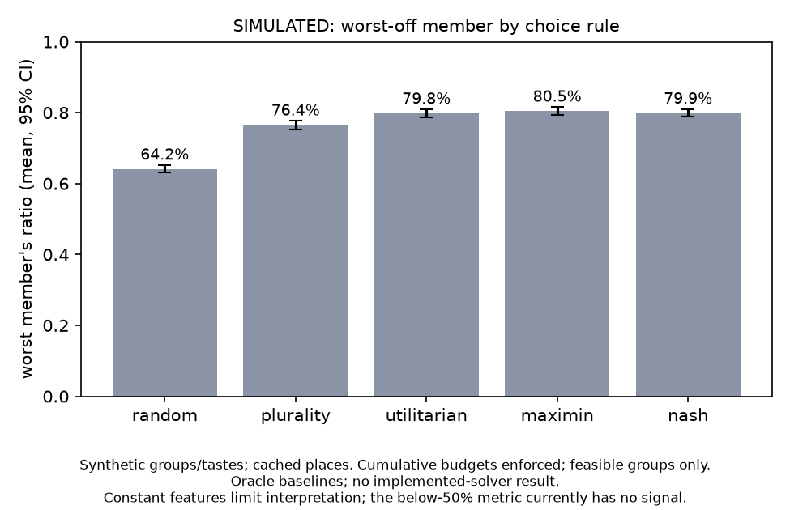

# Experiments (SIMULATED)

> **Everything here is SIMULATED.** Groups, tastes, constraints, and swipes are synthetic; ground truth is the synthetic taste vector. Only place features come from real data (`data/places.json`); review aspects may still be placeholders.

Seed 7; 1000 feasible groups of 3-5; generated 2026-10-23T22:13:48-07:00.

**Correction:** the earlier results did not enforce cumulative outing budgets. Those numbers and the earlier chart are withdrawn; all outputs below were regenerated with total-cost checks.

**Feasibility audit:** 0 selected-plan budget violations; 14 infeasible groups redrawn. Results describe feasible groups only, not the probability that an arbitrary group can find an outing.

**Caveat:** these features are identical for every place in this file, so they carry no signal: noise, crowd, wait, value, romance, service, outdoor, novelty. Rerun once `data/places.json` v2 (real review aspects) lands.

## Headline numbers (Experiment A)

- maximin: worst member at 80.5% of ideal; 0.0% of groups leave someone below 50%.
- utilitarian: worst member at 79.8% of ideal; 0.0% of groups leave someone below 50%.
- plurality: worst member at 76.4% of ideal; 0.0% of groups leave someone below 50%.
- random: worst member at 64.2% of ideal; 0.0% of groups leave someone below 50%.

Baselines are oracles: they see each synthetic member's true taste. The optional "ours" comparison also supplies the true taste as its posterior mean with sd 0.3; this is an oracle-centered uncertainty test, not evidence of learning from swipes.

## Experiment A: choice rules

| method | groups | worst ratio (95% CI) | Gini (95% CI) | share with someone < 50% (95% CI) | mean ratio |
| --- | --- | --- | --- | --- | --- |
| random | 1000 | 0.642 [0.631, 0.652] | 0.072 [0.069, 0.076] | 0.0% [0.0%, 0.4%] | 0.771 |
| plurality | 1000 | 0.764 [0.752, 0.777] | 0.059 [0.056, 0.063] | 0.0% [0.0%, 0.4%] | 0.907 |
| utilitarian | 1000 | 0.798 [0.787, 0.810] | 0.047 [0.044, 0.049] | 0.0% [0.0%, 0.4%] | 0.935 |
| maximin | 1000 | 0.805 [0.794, 0.816] | 0.045 [0.042, 0.048] | 0.0% [0.0%, 0.4%] | 0.930 |
| nash | 1000 | 0.799 [0.788, 0.810] | 0.046 [0.044, 0.049] | 0.0% [0.0%, 0.4%] | 0.935 |

Paired differences (method minus reference, same groups, bootstrap 95% CI over groups):

| method | vs | metric | matched groups | diff | 95% CI |
| --- | --- | --- | --- | --- | --- |
| random | maximin | minRatio | 1000 | -0.163 | [-0.175, -0.153] |
| random | maximin | gini | 1000 | +0.027 | [+0.025, +0.030] |
| random | maximin | below50 | 1000 | +0.000 | [+0.000, +0.000] |
| plurality | maximin | minRatio | 1000 | -0.041 | [-0.046, -0.036] |
| plurality | maximin | gini | 1000 | +0.014 | [+0.013, +0.016] |
| plurality | maximin | below50 | 1000 | +0.000 | [+0.000, +0.000] |
| utilitarian | maximin | minRatio | 1000 | -0.007 | [-0.008, -0.005] |
| utilitarian | maximin | gini | 1000 | +0.002 | [+0.001, +0.002] |
| utilitarian | maximin | below50 | 1000 | +0.000 | [+0.000, +0.000] |
| nash | maximin | minRatio | 1000 | -0.006 | [-0.007, -0.004] |
| nash | maximin | gini | 1000 | +0.001 | [+0.001, +0.002] |
| nash | maximin | below50 | 1000 | +0.000 | [+0.000, +0.000] |

## Experiment B: swipe selection

Not run yet (see notes).

## Notes

- ours SKIPPED: real API evaluation is disabled or its health check did not pass. No ours numbers were produced.
- Experiment B SKIPPED: real API evaluation disabled or health check failed. Scaffolding only.

## Method

- Taste: theta_i = sqrt(rho) * shared + sqrt(1 - rho) * noise_i, all N(0, I) over the 13 contract features; rho ~ U(0.2, 0.8) per group.
- Hard constraints per member: cuisine veto p=0.25 (second p=0.1), dessert-category veto p=0.05, cap of 2 vetoes; budget p=0.3 from [12, 15, 20, 25]; vegetarian p=0.15; travel cap p=0.25 from [10, 15, 20, 30] min, origin uniform within 1.5 km of the places' centroid. Groups with no feasible plan are redrawn.
- Hard filter: build-brief C4, except the dietary check applies to meals and desserts only (the agreed contract correction). Sum every stop's catalog cost and reject an outing above any member's non-null budget. Null is uncapped; zero is a real cap. No cap is raised.
- Utility, per-member per-category range normalization over the common group-hard-filtered place set, plan utility (mean over stops), ratio to the member's best group-feasible plan: build-brief C3. A category where a member's utility is flat gives every place 1.0.
- Plans: build-brief C4 templates, 15-min start grid in Sat 17:00-23:00, each stop starts on the grid after travel (haversine x1.3; 4.5 km/h up to 1.2 km, else 18 km/h), all stops open for their dwell, first leg within each member's travel cap.
- Rules: random feasible plan; plurality (each member votes one favorite, most votes wins); utilitarian (max sum of ratios); maximin (max min ratio, tie-break sum); Nash (max product of ratios). Ties broken at random.
- Metrics per group: min ratio, Gini of ratios, whether min ratio < 0.5. Continuous means and paired differences use bootstrap 95% CIs (2,000 resamples); the below-50% rate uses a Wilson 95% interval, including when no failures are observed.
- With the current flat features, activities and desserts get normalized value 1. Every two-stop plan therefore has utility at least 0.5 and every three-stop plan at least 2/3. The below-50% metric cannot distinguish these rules on this dataset. Better features may change the results in either direction.
- Maximin optimizes the same worst-member score used for evaluation under oracle tastes. Its win on that score is expected by construction; it does not establish that the implemented solver or real users do better.
- Optional API outputs are accepted only after non-stub health and per-response stub checks. Every returned plan is checked for known IDs, templates, exclusions, catalog costs/coordinates, cumulative budgets, vetoes, dietary needs, hours, dwell, grid, window and travel. Report invalid/empty/request failures separately; success-only utility is not an overall success rate.

Files: `results/exp_a_groups.csv`, `results/exp_a_summary.csv`, `results/exp_a_paired.csv`, `results/summary.json`, `results/chart.png`



## Reproduce

Python 3.11+; from the repository root:

```sh
python3 -m venv docs/experiments/.venv
docs/experiments/.venv/bin/python -m pip install -r docs/experiments/requirements.txt
docs/experiments/.venv/bin/python -m unittest discover -s docs/experiments -p 'test_*.py' -v
docs/experiments/.venv/bin/python docs/experiments/sim.py --no-api
```

Input SHA-256: `5365185d9fdda1ff3c4c4f1b51e558ae028f2e2fee89877ac988bdde6b7c3100`. Runtime versions: `{"matplotlib": "3.11.2", "numpy": "2.3.5", "python": "3.12.14"}`.

API evaluation is opt-in and does not load `api/.env` or modify that folder. When Eric confirms the real service is ready, configure `FASTAPI_BASE_URL` and `HUDDLE_SHARED_SECRET` privately in the environment or ignored root `.env`. Use a separate output directory so the baseline report stays intact:

```sh
docs/experiments/.venv/bin/python docs/experiments/sim.py --with-api --ours-groups 100 --b-users 0 \
  --out docs/experiments/api-results --readme docs/experiments/API_RESULTS.md
```

A stub, unavailable API or catalog-count mismatch produces no `ours` numbers. `--b-users 0` skips learning evaluation; enable it only after `/elicit/*` is real. An explicitly requested API evaluation exits nonzero if health fails, any requested plan is not scored, or the requested learning run fails entirely. Review method and API failure coverage with Max before presenting any numbers.
